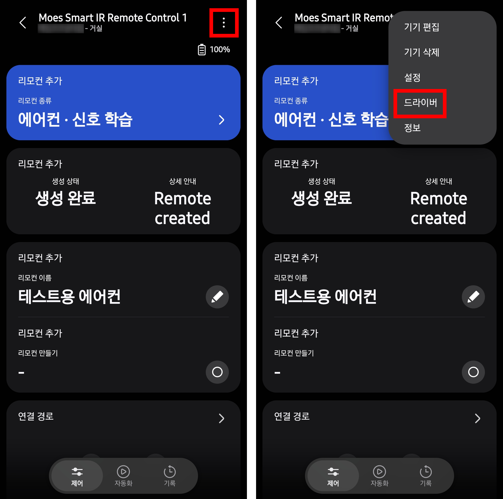
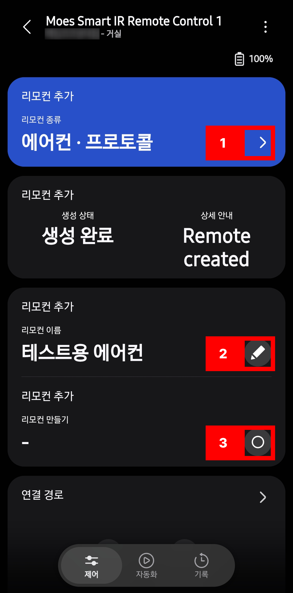
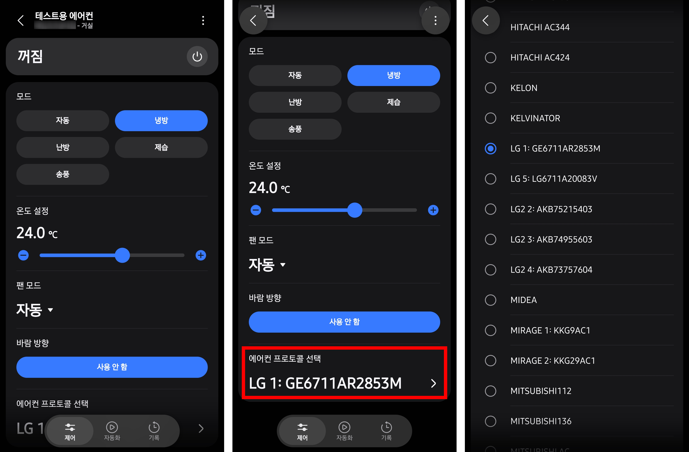
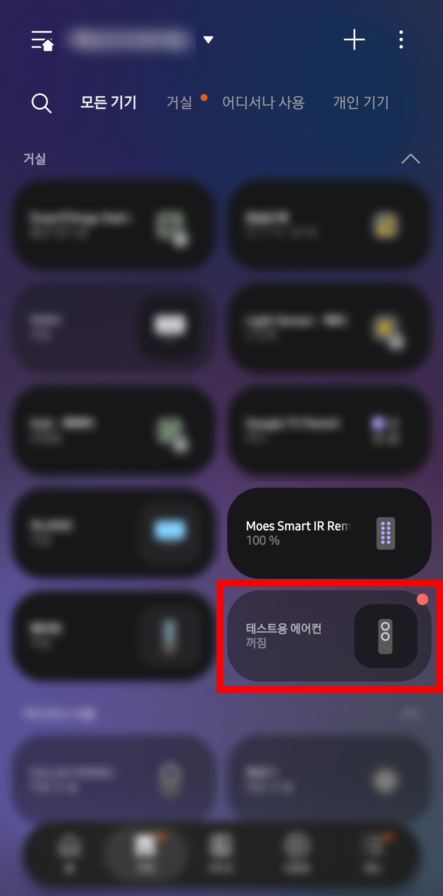
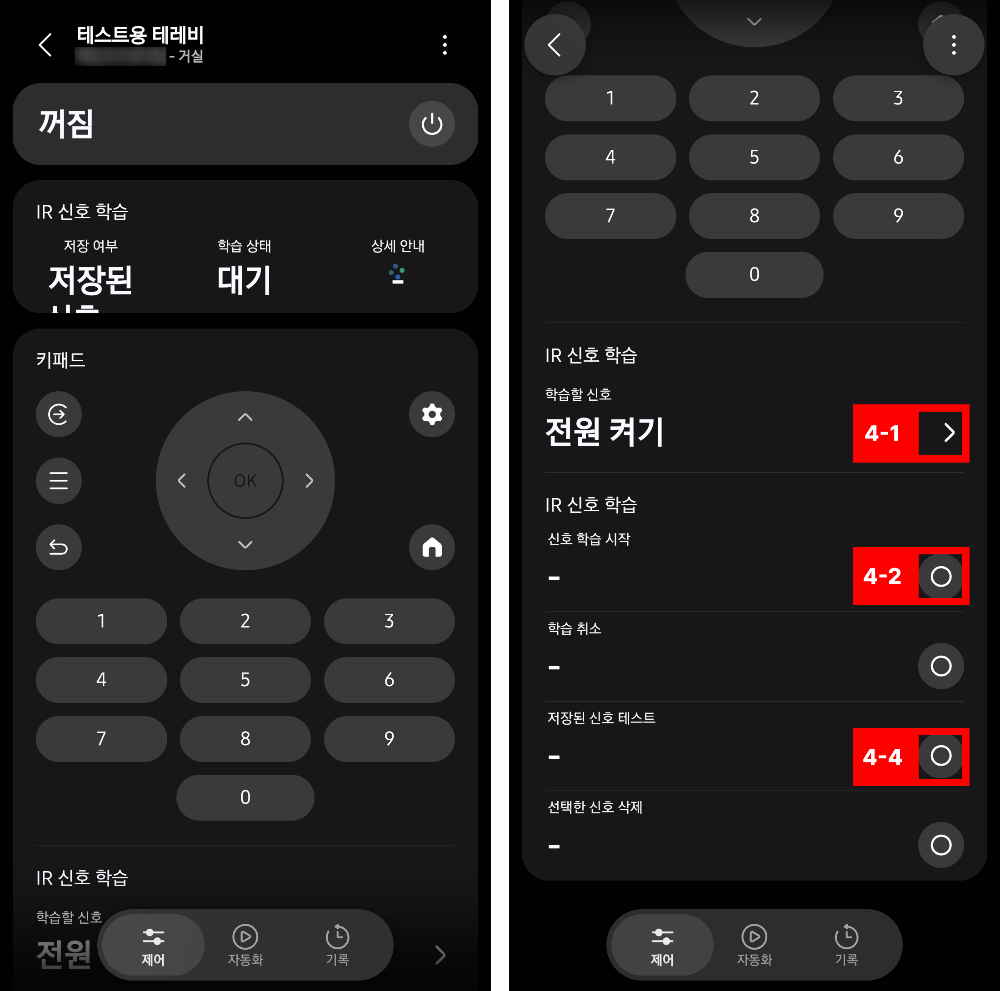

# SmartThings Generic IR Remote 사용 안내

이 안내서는 SmartThings Edge 드라이버를 설치하고 Zigbee IR 리모컨으로 에어컨, TV 및 기타 적외선 기기를 제어하는 방법을 설명합니다.

## 준비물

- SmartThings 허브
- TS1201 호환 Zigbee IR 리모컨
  - Tuya 또는 MOES 제품 중 Zigbee 모델인지 확인하세요. Wi-Fi 모델은 사용할 수 없습니다.
  - `TS1201` 또는 `TZ3290` 모델명이 표시된 제품이 가장 확실한 후보입니다.
- SmartThings 앱 및 삼성 계정

## 드라이버 설치 및 IR 리모컨 연결

1. [SmartThings Generic IR Remote 채널](https://bestow-regional.api.smartthings.com/invite/kVlnvQmk16l4)을 열고 삼성 계정으로 로그인합니다.
2. 집에 있는 SmartThings 허브를 채널에 등록(Enroll)합니다.
3. **Available Drivers**에서 **SmartThings Generic IR Remote**를 선택해 허브에 설치합니다.
4. 아직 등록하지 않은 IR 리모컨이라면 SmartThings 앱에서 **기기 추가 → 주변 기기 검색**을 실행하고, 리모컨의 페어링 절차를 시작합니다.
5. 리모컨이 이미 다른 드라이버에 등록되어 있다면 기기 화면 오른쪽 위 메뉴에서 **드라이버 → 다른 드라이버 선택**을 열고 **SmartThings Generic IR Remote**로 변경합니다.

드라이버 설치를 보여 주는 화면:

기기가 검색되지 않거나 페어링되지 않으면 정확한 모델과 Zigbee 지원 여부를 확인하세요. TS1201 호환 기기라도 하드웨어 리비전마다 동작이 다를 수 있습니다.

## 에어컨 리모컨 만들기

1. 물리 IR 리모컨 기기 화면에서 **리모컨 종류**를 열고 **에어컨 - 프로토콜**을 선택합니다.
   - 프로토콜을 찾을 수 없는 경우 **에어컨 - 학습** 또는 **에어컨 - 프로토콜 및 학습**을 선택해 상태별 신호 학습을 사용할 수 있습니다.
2. **리모컨 이름**을 입력합니다.
3. **리모컨 만들기**를 누릅니다. 새 에어컨 리모컨이 SmartThings 기기 목록에 추가됩니다.
4. 새 에어컨 기기를 열고 **에어컨 프로토콜 선택**에서 제조사와 리모컨 모델에 맞는 항목을 고릅니다. 모델명이 원래 리모컨에 표시되어 있다면 참고하세요. 제조사 이름만으로 확정하기 어려울 수 있으므로 실제 반응을 확인하며 선택합니다.
5. 모드, 목표 온도, 풍량, 지원되는 바람 방향을 설정하고 송신을 확인합니다.

프로토콜 방식은 에어컨의 상태 전체를 담은 IR 신호를 생성합니다. 목록의 선택지는 소프트웨어 프로토콜/모델 변형이며, 목록에 있다고 해서 특정 실물 에어컨에서 검증되었다는 뜻은 아닙니다.

### 에어컨 신호를 직접 학습해야 할 때

프로토콜 목록에 맞는 항목이 없거나 기기가 제대로 반응하지 않으면 에어컨의 **상태 학습** 기능을 사용합니다.

1. **편집 캡처 상태(송신 안 함)**를 켭니다.
2. SmartThings 화면에서 전원, 모드, 목표 온도, 풍량 및 바람 방향을 원하는 상태로 설정합니다. 이 단계는 초안 상태만 바꾸며 IR 신호를 보내지 않습니다.
3. 실물 리모컨에서도 같은 상태를 설정한 뒤 **학습**을 누르고 리모컨 버튼을 눌러 신호를 캡처합니다.
4. **테스트**로 저장한 상태를 송신해 에어컨이 반응하는지 확인합니다.
5. 캡처가 끝나면 편집 캡처 상태를 끕니다.

## TV, 선풍기 및 기타 리모컨 만들기

에어컨 외 리모컨도 위의 리모컨 생성 절차와 같습니다. **리모컨 종류**에서 용도에 맞는 항목을 선택하세요.

- **TV**: SmartThings 키패드와 탐색 버튼에 IR 신호를 연결합니다.
- **선풍기**: 현재는 전원 동작을 학습해 제어합니다.
- **일반 IR 스위치**: 전원 켜기/끄기 신호를 학습해 스위치로 사용합니다.
- **일반 IR 버튼**: 신호 하나를 학습하고 **누르기(Push)** 명령으로 반복 송신합니다.

## 신호 학습 및 테스트

1. 새 리모컨을 열고 **신호를 학습할 항목**을 선택합니다.
2. **선택한 신호 학습 시작**을 누릅니다.
3. 원래 리모컨을 IR 리모컨 쪽으로 향하고 해당 버튼을 누릅니다.
4. 학습 상태가 **저장됨**으로 바뀌면 **저장된 신호 테스트**를 눌러 확인합니다.

TV의 일부 신호는 기기 화면에 보이는 버튼 목록과 다르게 표시될 수 있습니다. 학습할 신호 목록에서 원하는 동작을 확인하세요.

## 문제 해결 및 참고 사항

- IR은 벽이나 장애물을 통과하지 못하므로 리모컨과 가전제품 사이에 시야가 확보되어야 합니다.
- SmartThings의 완료/상태 표시는 IR 전송이 끝났다는 뜻이며, 가전제품이 실제로 반응했다는 확인은 아닙니다. 기기 자체를 확인하세요.
- IR 리모컨 모델, 하드웨어 리비전, SmartThings 허브 및 제어할 가전제품 모델을 기록해 두면 호환성 문제를 진단하는 데 도움이 됩니다.
- [GitHub 저장소](https://github.com/Heartade/smartthings-generic-ir-remote)에서 소스 코드, 알려진 제한 사항 및 문제 제보 안내를 확인할 수 있습니다.
